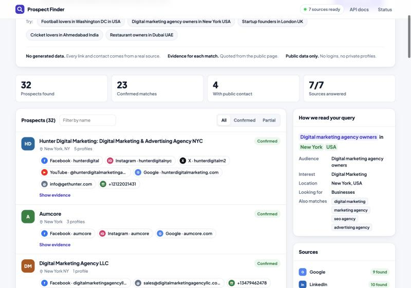
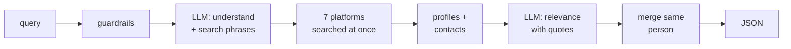

# AI-Powered Multi-Platform Prospect Discovery API

Type who you're looking for and where, for example *"Startup founders in London UK"*. You get back **real public profiles** from Google, LinkedIn, X, YouTube, Instagram, Facebook and Threads, merged per person, with any email, phone or WhatsApp link they've published.

**Nothing is made up.** Every name, link and contact comes from a real search or API response. The LLM only reads the query, writes search phrases and judges relevance, and it has to quote its evidence.



*Screenshot from a live run of the web UI. Its numbers differ slightly from the saved samples below because each run searches again.*

## Quick start

```bash
python -m venv .venv && source .venv/bin/activate
pip install -r requirements.txt
cp .env.example .env        # add GEMINI_API_KEY, GROQ_API_KEY, SERPER_API_KEY, YOUTUBE_API_KEY
uvicorn app.main:app --host 0.0.0.0 --port 4000
```

- http://localhost:4000: web UI
- http://localhost:4000/docs: API docs
- http://localhost:4000/health: which keys are set

All four keys have free tiers; see [docs/07-deploy.md](docs/07-deploy.md).

## API

```bash
curl -s -X POST http://localhost:4000/prospect-discovery \
  -H 'Content-Type: application/json' \
  -d '{"query": "Football lovers in Washington DC in USA"}'
```

```json
{
  "success": true,
  "query": "Football lovers in Washington DC in USA",
  "total_prospects": 1,
  "prospects": [
    {
      "name": "<name from the page title>",
      "location": "<where their own profile says they are>",
      "social_link": [
        {"platform": "LinkedIn", "link": "https://linkedin.com/in/<handle>"},
        {"platform": "Email", "link": "mailto:<published address>"}
      ],
      "match": "confirmed"
    }
  ]
}
```

This is the brief's shape (§5). I added `match`: `confirmed` means there's public evidence for both the interest and the location, `partial` means evidence for the interest only. The brief (§11) asks to tell verified from inferred.

- `?debug=true` also returns the parsed query, each platform's status, and the evidence for every link.
- Errors: `422` bad or blocked query, `401` missing key (when `API_KEY` is set), `429` too many requests, `503` the LLM is unreachable.

## Real results for the five test queries (§6)

<!-- results:start -->
Live run on 27 Nov 2026 with the submitted code.

| # | Query | Prospects | Confirmed | Location verified | Merged across platforms | Published contacts | Time |
|---|---|---|---|---|---|---|---|
| 1 | [Football lovers in Washington DC in USA](docs/samples/1-football-lovers-in-washington-dc-in-usa.json) | 11 | 6 | 6 | 0 | 1 | 14.7 s |
| 2 | [Digital marketing agency owners in New York USA](docs/samples/2-digital-marketing-agency-owners-in-new-york-usa.json) | 29 | 23 | 23 | 5 | 5 | 9.4 s |
| 3 | [Startup founders in London UK](docs/samples/3-startup-founders-in-london-uk.json) | 4 | 2 | 2 | 0 | 0 | 19.4 s |
| 4 | [Cricket lovers in Ahmedabad India](docs/samples/4-cricket-lovers-in-ahmedabad-india.json) | 1 | 1 | 1 | 0 | 0 | 13.2 s |
| 5 | [Restaurant owners in Dubai UAE](docs/samples/5-restaurant-owners-in-dubai-uae.json) | 4 | 4 | 4 | 1 | 10 | 15.9 s |
<!-- results:end -->

Each row links to the exact API response, with a `.debug.json` from the same run next to it. Results change between runs because search results change. Some queries return few profiles: I drop search results I can't verify (see [docs/08-known-limits.md](docs/08-known-limits.md)).

## How it works



| Doc | Topic |
|---|---|
| [01 Architecture](docs/01-architecture.md) | One diagram of the whole system |
| [02 Request flow](docs/02-request-flow.md) | The 13 steps of one request |
| [03 Platforms](docs/03-platforms.md) | How each platform is reached and its limits |
| [04 Relevance and duplicate rules](docs/04-relevance-and-duplicate-rules.md) | When a prospect counts as a match, and when profiles are merged |
| [05 LLM choice](docs/05-llm-choice.md) | Comparison, measured results, cost |
| [06 Reliability and safety](docs/06-reliability-and-safety.md) | Failures, guardrails, security |
| [07 Deploy](docs/07-deploy.md) | Local, Vercel, Docker |
| [08 Known limits](docs/08-known-limits.md) | What isn't great yet |

## LLM recommendation (§8)

<!-- evals:start -->
Measured with my own evals (`evals/`), going through the real code path:

| Model | Query understanding (20 queries) | Relevance (31 labelled snippets) | Speed | Cost / request |
|---|---|---|---|---|
| **Gemini 3.5 Flash-Lite** (default) | 19/20 answered, every answered query fully correct (one transient API failure) | 91.9% | ~1.5 s intent, ~2 s relevance | ~$0.0025 |
| Groq gpt-oss-20b (fallback) | 99% (20/20 valid, calls spaced for the free tier) | 83.9% | ~0.75 s per call | ~$0.0005 |

Groq is faster and cheaper and almost as good at reading the query, but clearly weaker at judging relevance, which is the step that decides what you see. So Gemini is primary. Groq's free tier allows 8,000 tokens per minute, which is fine for a fallback.

Recommendation: Gemini 3.5 Flash-Lite now (best measured accuracy, free key), Groq as fallback. Next I'd evaluate Claude Haiku 5.5 on the same sets; switching is one line in `.env`.
<!-- evals:end -->

Full comparison and cost notes: [docs/05-llm-choice.md](docs/05-llm-choice.md).

## Tests

```bash
pip install -r requirements-dev.txt
ruff check . && pytest -q          # offline tests, fake LLM and platforms
python -m evals.run --task dedup   # runs in CI
```

## Deploy

Vercel: `vercel link`, `./scripts/vercel_env.sh`, `vercel --prod`. Details in [docs/07-deploy.md](docs/07-deploy.md).

## Privacy

Only public data; no logins, no private profiles. Stored runs are deleted after 7 days.
