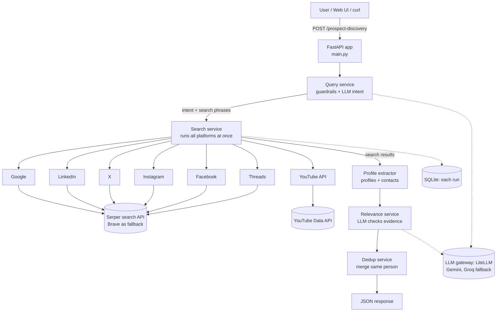

# 1. Architecture

One FastAPI service. A request goes through a fixed pipeline; each box below is one small module.



## Folders

```text
app/
  main.py              API, auth, rate limit, serves the web UI
  schemas.py           all request/response models
  prompts/             the two LLM prompts (versioned)
  platforms/           one file per platform (same pattern for all)
  services/            the pipeline steps (one file each)
  utils/               URL rules, contact validation, guardrails
  static/index.html    the web UI
tests/                 offline tests (fake LLM + fake platforms)
evals/                 small labelled datasets to measure the LLM
```

## Why it's shaped like this

- **One file per platform.** Adding a platform means one new file and one line in `platforms/__init__.py`.
- **The LLM is behind one small class** (`llm_service.py`), so changing the model is a config change.
- **Each step is a plain function or class** that takes its inputs as arguments. That's why the tests can swap in fakes and run offline.
