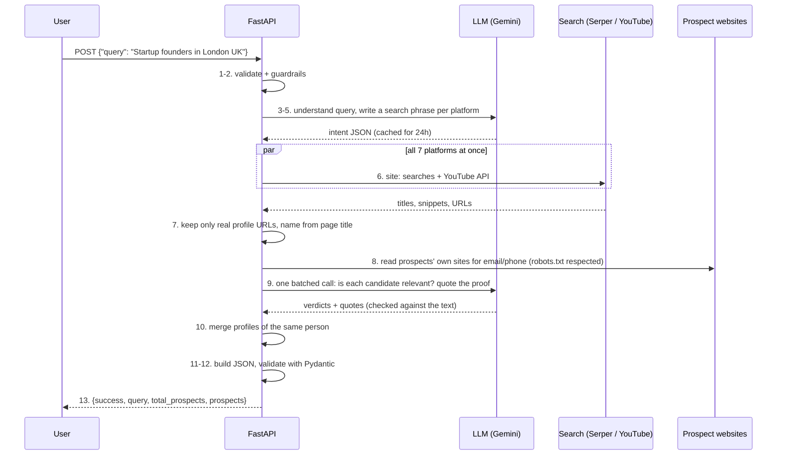
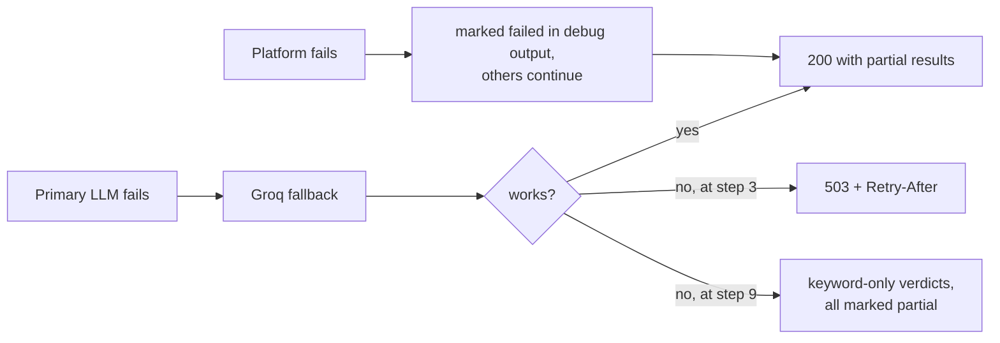

# 2. What happens in one request

The brief suggests a 13-step flow (§7). I kept its order.

## The steps in plain words

| Step | What it does | File |
|---|---|---|
| 1–2 | Rejects empty/long queries and queries targeting one named person or sensitive groups | `query_service.py`, `validators.py` |
| 3–5 | One LLM call returns interest, audience, location, and a search phrase for each platform | `query_service.py` |
| 6 | Runs all platforms concurrently; a failing platform only marks itself as failed | `search_service.py` |
| 7 | Keeps profile URLs only (no posts or articles); the name comes from the page title | `profile_extractor.py` |
| 8 | Reads up to 5 prospect websites for contacts and their own social links | `profile_extractor.py` |
| 9 | Keyword pre-filter, then one LLM call judges every candidate with quotes | `relevance_service.py` |
| 10 | Merges candidates that are clearly the same person or business | `deduplication_service.py` |
| 11–13 | Builds and validates the response | `prospect_service.py`, `main.py` |

## Time budget

The whole request has 30 seconds. Every step gets what's left, so a slow platform can't make the request hang. In my runs a request takes 8–17 seconds.

## When things fail

