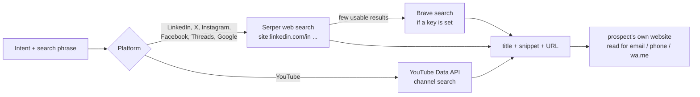

# 3. Platforms and how each one is reached

The brief says to use only official or authorised sources and never bypass logins. When I researched (late Nov 2026), I found that **only YouTube offers a public keyword search for profiles**. The others have no people-search API for outside apps, or keep it behind an approval process a 4-hour test can't get.

So I used an **authorised web-search API with `site:` queries** for those. The app reads only what the search result shows (title, snippet, URL) and never opens LinkedIn, Instagram, Facebook, X or Threads pages.

| Platform | Method | Why / limitation | Source |
|---|---|---|---|
| Google | Serper.dev (Google results) | Google's own Custom Search API is closed to new customers and ends 1 Jan 2027 | developers.google.com/custom-search |
| LinkedIn | `site:linkedin.com/in` (people), plus `/company` for business queries | No people-search API for third parties; scraping breaks LinkedIn's terms | learn.microsoft.com/linkedin |
| X | `site:x.com` | X API has no free tier (about $0.010 per user read) | docs.x.com/x-api/getting-started/pricing |
| YouTube | Official Data API | 100 search calls/day; no email/link fields, so contacts come from descriptions | developers.google.com/youtube/v3 |
| Instagram | `site:instagram.com` | Business Discovery needs an exact username; no keyword search | developers.facebook.com/docs/instagram-platform |
| Facebook | `site:facebook.com` | Page search needs App Review; people search was removed | developers.facebook.com/docs/pages-api |
| Threads | `site:threads.net` | Keyword search needs App Review | developers.facebook.com/docs/threads |
| Email | From public text and prospects' sites | Never guessed from name patterns | — |
| WhatsApp | Only published `wa.me` links | No discovery API exists; I don't turn a phone number into a WhatsApp link | faq.whatsapp.com |

## Why Serper

| Option | Free | Notes |
|---|---|---|
| **Serper.dev** (chosen) | 2,500 searches, no card | Real Google results; `site:` works as typed |
| Brave Search API (fallback) | $5 credit/month | Independent index, direct URLs |
| SerpAPI | 250/month | Expensive at small volume |
| Tavily / Exa | Some free credit | AI-search style; `site:` not the main feature |

## Something I found while testing

Serper returns many results as opaque `https://www.google.com/goto?url=...` links instead of the real profile URL, often 5–7 of 10 for LinkedIn. I tried resolving them. Sometimes I got a Google interstitial page, and once the link led to a **different person's** profile.

So I drop them: a link I can't verify never reaches the output. This is the main reason some queries return few profiles. If Serper returns fewer than 4 usable results, the app also asks Brave, when a Brave key is set.

## Platform quirks handled in code

- `twitter.com` → `x.com`, `threads.com` → `threads.net`, `uk.linkedin.com` → `linkedin.com`
- Handles compared case-insensitively (`x.com/GCAMotera` = `x.com/gcamotera`); YouTube channel IDs stay case-sensitive
- Posts, reels, groups and search pages are rejected; only profile URLs count
- Page titles like "Contact us | Acme" or "Jane undefined" are cleaned before taking the name
