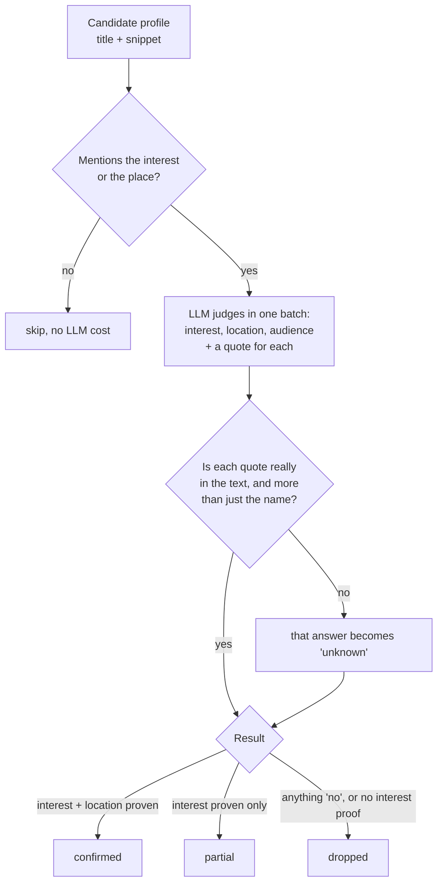
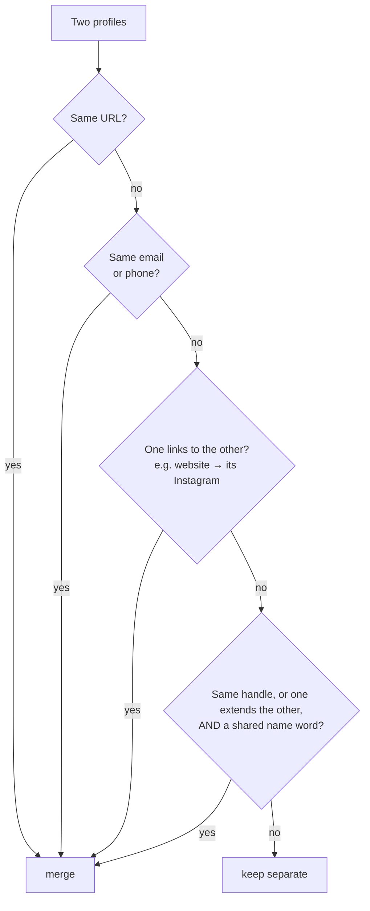

# 4. Relevance and duplicate rules

These two steps carry most of the marks (§4 Sections 3 and 5), so I kept the rules strict and easy to explain.

## Relevance: is this candidate a real match?

The rules:
- **A name is never enough.** "Red Devils DC" quoting the account called Red Devils DC proves nothing. A business name like "Rags To Riches Restaurant" can show the business type, but only if the location is proven by other text.
- **Interest and location each need their own quote.** One phrase can't justify everything.
- **Location shown is quoted from the profile.** If someone's profile says "Silver Spring, Maryland", that's what you see, not the query's "Washington DC".
- **The audience matters.** For "football lovers" (people), stadiums, teams, radio stations and anyone who looks under 18 are rejected. For "restaurant owners" (businesses), directories and "top 10" lists are rejected.
- **Code double-checks two things the model got wrong once.** For people queries, a name with organisation words (group, club, academy, news...) is never a prospect. A place in possessive form ("the best of Dubai's restaurants") is not a location.
- If the LLM is down, a keyword check is used and nothing is marked "confirmed".

## Merging: is this the same person?

Examples from real runs:
- **Hunter Digital:** Instagram `@hunterdigital`, X `@hunterdigital_`, Facebook `hunterdigitalagency` and `hunterdigital.com` became one prospect with all its links.
- **Copify:** `x.com/copifycom` and `youtube.com/@copifycom` ("Copify Digital Marketing Agency") were merged.
- **Two "John Smith"s** with different handles and no shared contact stay separate. I'd rather show a duplicate than mix two people's contact details.

A website's links only count if they look like the site's **own** accounts (handle matches the domain or the name), and only one per platform. Without this, a club's site linking to a player's X account would merge the player into the club.

## How I checked it

- Tests for every merge rule and every "don't merge" case (`tests/test_prospect_discovery.py`)
- A small labelled set in `evals/datasets/dedup.jsonl`, which runs in CI
