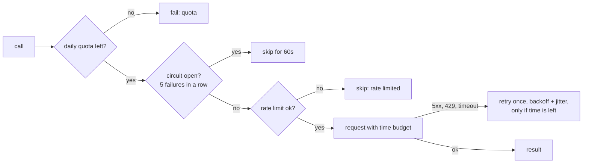

# 6. Reliability and safety

## When an outside service misbehaves

Every call to Serper, Brave or YouTube goes through one guard:

- **Retries are safe** because searches only read; repeating one can't create anything. They still cost credits, so there's only one retry.
- **One platform failing never affects the others.** Each runs as its own task, and any error becomes a status line.
- **The LLM** has its own fallback (Gemini → Groq) through LiteLLM. The fallback model *is* the retry, so calls don't pile up past the time budget.

## Repeated and duplicate requests

- The same query within 24 hours reuses the parsed intent; search results are reused for 6 hours.
- Two identical requests at the same time share one run.
- An `Idempotency-Key` header returns the stored answer instead of searching again.

## Guardrails

| Where | Rule |
|---|---|
| Before anything runs | Reject queries with links, emails or phone numbers, aimed at one named person ("John Smith's phone"), or targeting people by health, religion, orientation, politics or age |
| Search snippets → LLM | Treated as data: wrapped in tags, and the model may only answer for the IDs it was given |
| LLM output | Every quote must be in the source text; the LLM never outputs URLs, emails or phones |
| Before responding | Every link is re-checked against its platform's URL rule; phones must belong to the searched country |

Professions that only mention a sensitive word, like "dentists treating patients" or "Christian bookstore owners", are allowed.

## Security

- API keys only in env vars; `.env` is git-ignored and excluded from Vercel uploads.
- Keys are sent in headers, never in URLs, so they don't show up in traces.
- An optional `API_KEY` protects the public endpoint, compared in constant time.
- Rate limiting per client IP: 10 per minute by default.
- Reading prospect websites: robots.txt respected, redirects checked hop by hop, internal or private IP addresses refused, at most 1 MB per page.
- The web UI never inserts HTML from results. It only creates text nodes and allows `http`, `https`, `mailto` and `tel` links.

## Privacy

Only public data. Stored runs (SQLite) are deleted after 7 days. Results for UK/EU queries contain personal data under the GDPR.

## Tracing

Each request is one trace (Logfire / OpenTelemetry), with a span per step and per platform. LLM spans record the model, tokens and cost, and whether the fallback was used. The response has an `X-Trace-ID` header to find it.
