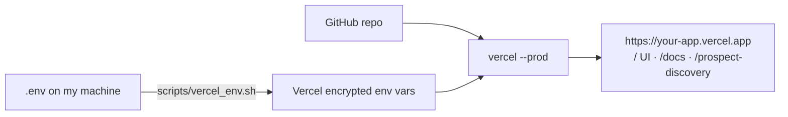

# 7. Running and deploying

## Locally

```bash
python -m venv .venv && source .venv/bin/activate
pip install -r requirements.txt
cp .env.example .env      # fill in the keys
uvicorn app.main:app --host 0.0.0.0 --port 4000
```

Open http://localhost:4000 for the UI, `/docs` for the API, and `/health` to see which keys are set.

| Key | Where | Free |
|---|---|---|
| `GEMINI_API_KEY` | aistudio.google.com | yes |
| `GROQ_API_KEY` | console.groq.com | yes |
| `SERPER_API_KEY` | serper.dev | 2,500 searches |
| `YOUTUBE_API_KEY` | Google Cloud → YouTube Data API v3 → API key ("Public data") | yes |
| `BRAVE_API_KEY` | brave.com/search/api | optional |

## On Vercel



```bash
npm i -g vercel
vercel link
./scripts/vercel_env.sh     # copies non-empty .env values to Vercel
vercel --prod
```

- Vercel finds `app/main.py` automatically. `vercel.json` gives it 60 s.
- Keys never go in `vercel.json`, because that file is public.
- Set `API_KEY` before sharing the link; the UI then asks for it.
- On Vercel, SQLite lives in `/tmp` and is per instance, so stored runs don't persist. That's fine for a demo.

## Docker (alternative)

```bash
docker build -t ai-prospect-discovery .
docker run -p 4000:4000 --env-file .env ai-prospect-discovery
```

## Tests and evals

```bash
pip install -r requirements-dev.txt
ruff check . && pytest -q
python -m evals.run --task dedup
python -m evals.run --task intent --models gemini/gemini-3.5-flash-lite,groq/openai/gpt-oss-20b
```
